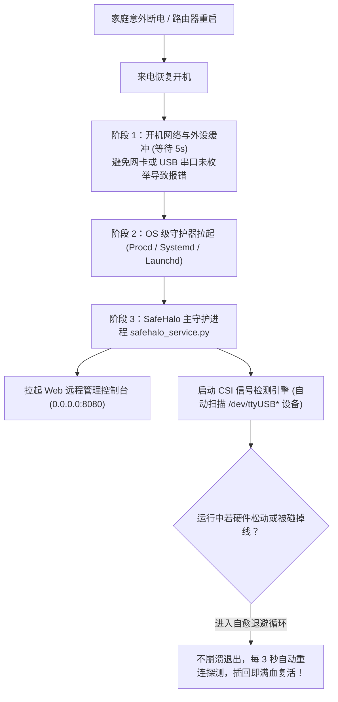

# SafeHalo 断电自动恢复与开机自启指南

针对家庭养老与独居老人守护场景，**意外停电、跳闸或插头松动恢复后，系统必须实现 100% 无人值守的全自动拉起与自愈**，严禁依赖人工登录终端敲命令启动。

SafeHalo 提供了工业级的断电自愈守护链条，全面适配 **OpenWrt 路由器**、**Linux/树莓派** 与 **macOS**。

---

## 一、断电自愈的核心技术保障



1. **开机缓冲防冲死（Grace Period）**：开机后自动等待 3~5 秒，确保 WiFi AP 射频驱动与 USB 串口设备驱动完全枚举完毕，防止冷启动时端口不存在而崩溃。
2. **串口热插拔断线自愈（Auto-Reconnect Loop）**：当老人或猫狗碰松了数据线，或路由器被临时重启，算法引擎自动捕获断开异常，记录 `ROUTER_OFFLINE` 并进入毫秒级休眠重试，重新插入数据线后秒级恢复检测。
3. **OS 进程级无限复活（Respawn）**：若遭遇断电导致的段错误或异常 Crash，系统的 Procd / Systemd 守护器将在 5 秒内无限次自动重启拉起。

---

## 二、OpenWrt 路由器部署（断电自动开机运行）

OpenWrt 原生使用 `procd` 作为顶级进程管理器。

### 1. 一键安装服务

在路由器终端运行：
```bash
sh /root/SafeHalo/scripts/install_openwrt_service.sh
```

或手动执行：
```bash
# 复制初始化脚本
cp /root/SafeHalo/scripts/openwrt_safehalo.init /etc/init.d/safehalo
chmod +x /etc/init.d/safehalo

# 启用开机自启 (自动在 /etc/rc.d/ 建立 S99safehalo 软链接)
/etc/init.d/safehalo enable

# 立即启动
/etc/init.d/safehalo start
```

### 2. 常用管理命令
- **查看运行状态**：`/etc/init.d/safehalo status`
- **查看运行日志**：`logread -f | grep SafeHalo`
- **重启服务**：`/etc/init.d/safehalo restart`
- **关闭自启**：`/etc/init.d/safehalo disable`

---

## 三、Linux / 树莓派 / 边缘主机部署（Systemd）

适用于 Ubuntu、Debian、Armbian、树莓派 Raspberry Pi OS 等环境。

### 1. 一键安装与启用
```bash
sudo bash scripts/install_systemd_service.sh
```

### 2. 常用管理命令
- **查看服务状态**：`sudo systemctl status safehalo`
- **实时滚动日志**：`journalctl -u safehalo -f`
- **重启服务**：`sudo systemctl restart safehalo`
- **停止服务**：`sudo systemctl stop safehalo`

---

## 四、macOS 开发机本地部署（Launchd）

适用于使用 Mac 笔记本或 Mac mini 作为本地测试中枢的场景。

### 1. 一键安装与载入
```bash
bash scripts/install_macos_launchd.sh
```

### 2. 常用管理命令
- **检查是否存活**：`launchctl list | grep safehalo`
- **查看标准输出日志**：`tail -f logs/launchd_stdout.log`
- **卸载停止自启**：`launchctl unload ~/Library/LaunchAgents/com.safehalo.service.plist`

---

## 五、断电自愈验证测试

您可以按照以下流程模拟断电复原验证：

1. **模拟进程崩溃**：
   ```bash
   pkill -9 -f safehalo_service.py
   ```
   观察 5 秒内，`procd` 或 `systemd` 是否全自动重新将服务拉起，Web 界面依然保持可用。
2. **模拟物理拔插 USB 串口**：
   在检测运行中直接拔下 ESP32 接收端的数据线，控制台将输出：
   ```text
   [WARNING] 数据读取中断或硬件掉电，正在进入自愈重连流程...
   [INFO] 正在建立硬件连接: auto...
   ```
   重新插上数据线后，系统自动识别设备并重新进入校准与守护状态，无需任何人工命令介入。
