# SafeHalo 接入 Home Assistant 智能家居平台全指南

SafeHalo 原生支持无缝接入 **Home Assistant (HA)**，将路由级 Wi-Fi CSI 与毫米波雷达空间感知转化为智能家居体系内的标准化实体（Entities），实现 **全屋智能设备联动**（如老人跌倒全屋灯光变红闪烁、智能音箱语音警报、手机高优先级强提醒推送等）。

---

## 1. 接入方案对比与选型

SafeHalo 提供三种接入方式，满足不同网络与部署习惯：

| 接入方式 | 复杂度 | 实时性 | 推荐场景 | 说明 |
| :--- | :---: | :---: | :--- | :--- |
| **方案 A: MQTT 自动发现 (推荐)** | **零配置** | 毫秒级 | **绝大多数 Home Assistant 用户** | 标准 MQTT Discovery 协议，HA 自动发现 9 个实体，无需写 YAML (Python 生产服务原生内置) |
| **方案 B: RESTful 传感器** | 极低 | 1秒轮询 | 局域网未搭建 MQTT Broker / 运行 Rust Daemon | 通过 `/api/ha/status` 轮询 JSON 遥测，双引擎 100% 契约一致 |
| **方案 C: Webhook 自动化** | 极低 | 实时事件 | 仅需联动特定自动化流程 | 跌倒或入侵时直接 HTTP POST 触发 HA 自动化，Rust 支持重试与去重 |

---

## 2. 方案 A: MQTT 自动发现 (零门槛即插即用 · 最优解)

### 2.1 工作原理
Home Assistant 内置了 **MQTT Discovery 机制**。SafeHalo 会在连接到 HA 的 MQTT Broker（如 Mosquitto Broker 插件）后，自动向 `homeassistant/<component>/safehalo/.../config` 主题广播设备元数据。

Home Assistant 的【配置】->【设备与服务】中将立即弹出一台名为 **SafeHalo 空间感知网关** 的设备，并自动挂载以下 **9 个标准实体**：

```mermaid
graph LR
    subgraph GATEWAY["SafeHalo 空间感知网关"]
        S1["binary_sensor.safehalo_fall\n(老人跌倒警报, class: safety)"]
        S2["binary_sensor.safehalo_presence\n(人体存在, class: presence)"]
        S3["binary_sensor.safehalo_motion\n(空间活动走动, class: motion)"]
        S4["binary_sensor.safehalo_pet\n(宠物地面活动, 已过滤)"]
        S5["sensor.safehalo_human_state\n(空间感知状态枚举)"]
        S6["sensor.safehalo_radar_height\n(躯干离地高度 Z轴, 单位: m)"]
        S7["sensor.safehalo_respiration_rate\n(活体呼吸微动频率, 单位: bpm)"]
        S8["sensor.safehalo_fused_confidence\n(双模融合置信度, 单位: %)"]
        S9["button.safehalo_inspect_now\n(启动定向微动核验按钮)"]
    end

    GATEWAY -->|MQTT Auto-Discovery| HA["Home Assistant 系统"]
```



### 2.2 启动方式
在启动 SafeHalo 主服务时，只需追加 `--ha-mqtt-host` 参数：

```bash
# 假设 Home Assistant 的 IP 为 192.168.1.100 (Mosquitto 默认端口 1883)
python3 safehalo_service.py \
  --serial auto \
  --ha-mqtt-host 192.168.1.100 \
  --ha-mqtt-port 1883 \
  --ha-mqtt-user mqtt_user \
  --ha-mqtt-pass mqtt_secret
```

> **提示**：SafeHalo 内置了纯 Python 标准库编写的轻量级 MQTT 客户端（[`MiniMQTTClient`](file:///Users/yifanwang/workspace/SafeHalo/src/safehalo/ha_discovery.py#L35)），**无需在 OpenWrt 路由器上执行 `pip install paho-mqtt`**，完全零依赖。

---

## 3. 方案 B: RESTful 传感器 (免 MQTT 方式 · 适配 Python 服务与 Rust Daemon)

若家中 Home Assistant 尚未启用 MQTT，可在 HA 的 `configuration.yaml` 中添加以下原生 REST 配置（Python 服务默认端口为 `8080`，Rust Daemon 默认端口为 `8091`）：

```yaml
# Home Assistant configuration.yaml
sensor:
  - platform: rest
    name: "SafeHalo 全局人体状态"
    # 根据部署环境选择端口：Python 服务为 8080，OpenWrt Rust daemon 为 8091
    resource: "http://192.168.1.1:8091/api/ha/status"
    value_template: "{{ value_json.human_state }}"
    scan_interval: 1
    json_attributes:
      - fall_detected
      - presence
      - motion
      - pet_activity
      - security_mode
      - radar_height_m
      - respiration_bpm
      - confidence
      - decision_reason

binary_sensor:
  - platform: template
    sensors:
      safehalo_fall_alarm:
        friendly_name: "老人跌倒警报"
        device_class: safety
        value_template: "{{ state_attr('sensor.safehalo_quan_ju_ren_ti_zhuang_tai', 'fall_detected') == true }}"
      safehalo_human_presence:
        friendly_name: "室内有人存在"
        device_class: presence
        value_template: "{{ state_attr('sensor.safehalo_quan_ju_ren_ti_zhuang_tai', 'presence') == true }}"
      safehalo_motion:
        friendly_name: "空间有人走动"
        device_class: motion
        value_template: "{{ state_attr('sensor.safehalo_quan_ju_ren_ti_zhuang_tai', 'motion') == true }}"
      safehalo_pet:
        friendly_name: "宠物地面活动"
        device_class: presence
        icon_template: "mdi:paw"
        value_template: "{{ state_attr('sensor.safehalo_quan_ju_ren_ti_zhuang_tai', 'pet_activity') == true }}"
```

---

## 4. 方案 C: Webhook 自动化触发 (实时毫秒级推送)

在 Home Assistant 中创建 Webhook 触发器：
1. 进入【配置】->【自动化与场景】->【添加自动化】。
2. 触发器类型选择 **Webhook**，设置 Webhook ID 为 `safehalo_fall`（或通过 Web UI 控制台【通知渠道配置】中直接填入 HA Webhook URL）。
3. SafeHalo 启动参数或控制台配置：`--ha-webhook http://192.168.1.100:8123/api/webhook/safehalo_fall`。
4. 一旦确诊跌倒，SafeHalo 将立即向该 Webhook 发送标准 JSON 载荷（Rust Daemon 支持带指数退避的重试持久队列与 30s 同房间去重）：
   ```json
   {
     "event_id": "evt_1700000000_1234",
     "event_type": "FALL_ALARM",
     "room": "主卧卫生间",
     "household_id": "H01",
     "confidence": 0.96,
     "respiration_bpm": 18.0,
     "details": "跌倒确诊：姿态冲击后处于持续静止状态",
     "timestamp": 1700000000.0
   }
   ```

---

## 5. Home Assistant 实用自动化联动模版

### 5.1 自动化 1: 跌倒发生时全屋灯光变红 + 音箱语音播报 + 手机紧急推送
当 SafeHalo 确诊跌倒时：
- 全屋智能灯调至红色、亮度 100%；
- 智能音箱（小爱音箱 / HomePod / 天猫精灵 / Google Home）播报语音；
- 手机 App 弹出最高优先级 Critical 紧急提醒（即便手机静音也能响铃）。

```yaml
alias: "【SafeHalo】老人跌倒全屋紧急响应"
description: "检测到老人跌倒，触发全屋灯光预警、TTS语音广播及手机紧急推送"
trigger:
  - platform: state
    entity_id: binary_sensor.safehalo_fall
    to: "on"
action:
  # 1. 全屋灯光亮红灯
  - service: light.turn_on
    target:
      entity_id: all
    data:
      rgb_color: [255, 0, 0]
      brightness: 255

  # 2. 智能音箱语音广播 (以 media_player 为例)
  - service: tts.speak
    target:
      entity_id: media_player.living_room_speaker
    data:
      message: "紧急提醒！检测到客厅有人员跌倒倒地未起，请尽快查看！"
      cache: false

  # 3. 手机 App 紧急通知 (支持 iOS 突破静音强提醒)
  - service: notify.notify
    data:
      title: "🚨【紧急报警】SafeHalo 侦测到跌倒！"
      message: "检测到持续地面静止，测定高度低于0.35m，请立即确认！"
      data:
        push:
          sound:
            name: "default"
            critical: 1
            volume: 1.0
        actions:
          - action: "CALL_NEIGHBOR"
            title: "拨打邻居/物业电话"
          - action: "VIEW_CAMERA"
            title: "查看实时监控"
mode: single
```

### 5.2 自动化 2: 夜间起夜微光照明联动
当夜间老人起身后走动，无感自动开启柔和地脚灯（避免摸黑摔倒）：

```yaml
alias: "【SafeHalo】夜间起夜自动照明"
description: "夜间感知到有人活动但未开灯时，点亮卧室夜灯"
trigger:
  - platform: state
    entity_id: binary_sensor.safehalo_motion
    to: "on"
condition:
  - condition: time
    after: "23:00:00"
    before: "06:30:00"
  - condition: state
    entity_id: light.bedroom_main_light
    state: "off"
action:
  - service: light.turn_on
    target:
      entity_id: light.night_light
    data:
      brightness: 20
```

---

## 6. Lovelace 仪表盘卡片配置示例

将以下 YAML 片段粘贴至 Home Assistant 仪表盘手动卡片，即可生成精美的感知仪表盘：

```yaml
type: vertical-stack
cards:
  - type: custom:mushroom-title-card
    title: SafeHalo 空间安全监控
    subtitle: 路由级 Wi-Fi CSI 与毫米波雷达双模态感知

  - type: horizontal-stack
    cards:
      - type: custom:mushroom-entity-card
        entity: binary_sensor.safehalo_fall
        name: 跌倒报警
        icon_color: red
      - type: custom:mushroom-entity-card
        entity: binary_sensor.safehalo_presence
        name: 人体存在
        icon_color: green
      - type: custom:mushroom-entity-card
        entity: binary_sensor.safehalo_pet
        name: 宠物活动
        icon_color: orange

  - type: entities
    title: 实时遥测指标
    entities:
      - entity: sensor.safehalo_human_state
        name: 当前状态
      - entity: sensor.safehalo_radar_height
        name: 空间高度 (Z)
      - entity: sensor.safehalo_respiration_rate
        name: 呼吸微动
      - entity: sensor.safehalo_fused_confidence
        name: 决策置信度
      - entity: button.safehalo_inspect_now
        name: 启动主动微动扫描
```

---

## 7. Python 生产服务与 Rust 轻量 Daemon 能力矩阵与架构边界说明

SafeHalo 针对不同硬件部署场景提供了两套引擎。两套引擎在核心跌倒状态机、质询应答拦截、安防模式与 Webhook 载荷契约上保持 **100% 行为与数据等价**：

| 能力维度 | Python 生产服务 (`safehalo_service.py`) | Rust 轻量 Daemon (`experiments/rust-daemon`) | 架构定位与选型建议 |
| :--- | :---: | :---: | :--- |
| **部署资源占用** | 内存 ~25-40MB，需要 Python 运行时 | 内存 **< 2MB**，单个无依赖静态二进制文件 | OpenWrt 路由器、低闪存低内存边缘网关优先用 Rust；PC/树莓派/NAS 优先用 Python |
| **Wi-Fi CSI 跌倒检测** | ✅ 完整支持（四段式质询闭环） | ✅ 完整支持（100% 位级等价） | 核心算法内核双引擎完全等价 |
| **安防布撤防 (`SecurityGuard`)** | ✅ 4 种模式 | ✅ 4 种模式（离家/夜间/宵禁/跌倒守护） | 均支持 HA 联动切换 |
| **告警可靠性与持久化队列** | ✅ 30s 同房间去重 | ✅ 指数退避重试 + 待发落盘 + 死信队列 + 去重 | 弱网环境下 Rust Daemon 具备更高通知抗丢包能力 |
| **HA MQTT Auto-Discovery** | ✅ 原生内置零依赖 MiniMQTT 自动注册 | ⚠️ 建议走方案 B (RESTful) 或 方案 C (Webhook) | Rust 保持零依赖与极小体积，免去 MQTT 第三方依赖膨胀 |
| **毫米波雷达双模融合 (`Radar`)** | ✅ 支持 (LD2410 / MR60 等) | ⚠️ 单模 CSI，状态返回 `radar_online: false` | 毫米波串口解析运行于 Python 服务；Rust 控制台明确标记单模 |
| **多 AP 空间分集 (`MultiLink`)** | ✅ 支持多路由 Mesh 空间融合 | ⚠️ 单链路模式，状态返回 `multilink.supported: false` | 复杂大户型多 AP 融合部署在 Python 服务 |
| **长周期作息画像 (`Routine`)** | ✅ 支持 24h 活动画像与晨起/起夜异常 | ⚠️ 建议由 Home Assistant 原生历史传感器接管 | 避免嵌入式路由器 Flash 频繁写入海量作息历史 |

> **优雅降级原则**：当 Home Assistant 接入 Rust 轻量 Daemon 时，系统通过 `/api/ha/status` 与 `/api/status` 明确声明未启用的子系统状态（`enabled: false, supported: false`），控制台展示为「未启用 / 单模 CSI」，杜绝虚假在线或静默异常。
