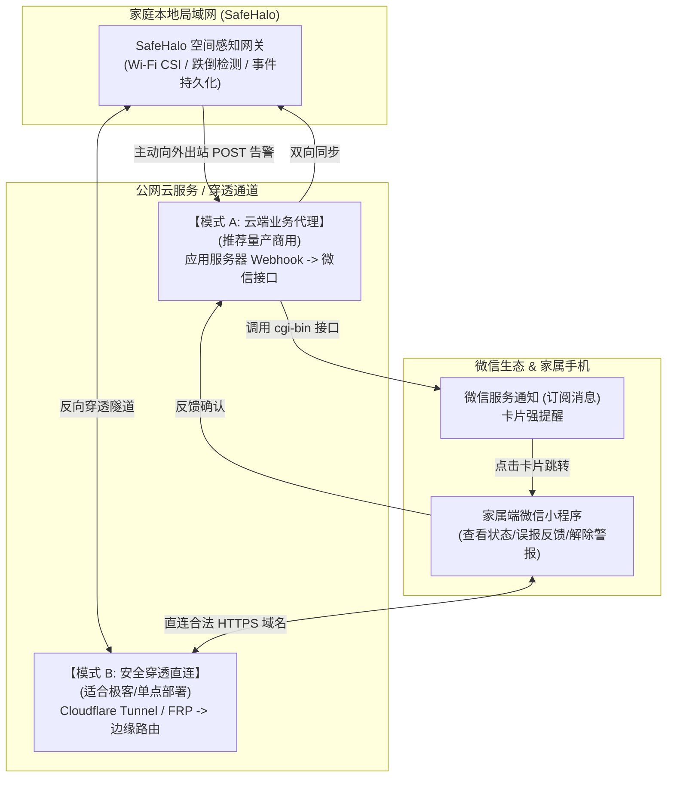

# SafeHalo 家属端微信小程序对接与公网穿透联调指南

本指南面向将 SafeHalo 接入微信小程序（含微信服务通知/订阅消息与家属端看护看板）的开发者与工程部署人员，覆盖 **架构选型**、**微信 HTTPS 安全规范**、**内网穿透方案 (Cloudflare Tunnel / FRP / Tailscale)** 与 **端到端联调实测**。

---

## 1. 总体架构与接入模式

微信小程序有严格的安全合规机制：
1. **强制 HTTPS / WSS**：所有网络请求域名必须配置合法 CA 机构签发的 TLS 证书（不支持自签名证书，不支持直接使用 IP 访问）。
2. **合法域名白名单**：必须在微信公众平台「开发管理」->「开发设置」->「服务器域名」中配置 `request` / `socket` 域名。

针对家庭网关（运行在家庭局域网内的 OpenWrt 路由器或微型主机），SafeHalo 提供两套成熟的对接方案：



---

## 2. 模式 A：云端业务代理 (量产推荐 · 最优解)

### 2.1 工作流程
1. 家庭网关 SafeHalo **仅需对外发起普通的出站 HTTPS 请求**（无需公网 IP，无需家庭路由做端口映射）。
2. 跌倒或异常发生时，SafeHalo 立即向云端业务服务器 Webhook POST 事件载荷：
   ```json
   {
     "event_id": "evt_1700000000_1234",
     "event_type": "FALL_ALARM",
     "household_id": "H01",
     "room": "客厅",
     "confidence": 0.96,
     "respiration_bpm": 18.0,
     "details": "确诊跌倒：姿态冲击后处于持续静止状态",
     "page_path": "pages/alert/detail?event_id=evt_1700000000_1234"
   }
   ```
3. 云端后端（持有小程序 AppID 与 AppSecret）接收到事件后，调用微信官方接口 `POST https://api.weixin.qq.com/cgi-bin/message/subscribe/send`，直接将订阅卡片推入指定家属的微信服务通知列表。
4. 家属点击通知进入小程序，提交“真实确认”或“误报反馈”。云端后端处理后通过 REST API 回调同步至家庭 SafeHalo 网关。

### 2.2 网关参数配置
在 SafeHalo 启动参数或 Web 控制台【通知渠道配置】中填入：
- `--miniprogram-url https://api.yourdomain.com/v1/safehalo/events`
- `--miniprogram-token your_secure_bearer_token`

---

## 3. 模式 B：内网穿透直连方案 (免云端自建服务器)

如果希望家属小程序或远程管理人员直接访问家庭网关控制台与 API，需解决公网域名与 SSL 证书问题。以下推荐三种经过工程验证的穿透方案：

### 3.1 方案 1: Cloudflare Tunnel (免费 · 零公网IP · 自动证书)
Cloudflare Tunnel 允许网关仅通过轻量级守护进程 `cloudflared` 向 Cloudflare 边缘节点建立出站 HTTP/2 连接，自动生成全球公信力的 SSL 证书。

1. **在 OpenWrt 或 Linux 网关安装 cloudflared**：
   ```bash
   # OpenWrt 安装
   opkg update && opkg install cloudflared
   ```
2. **创建隧道并绑定域名**：
   ```bash
   cloudflared tunnel login
   cloudflared tunnel create safehalo-home
   ```
3. **配置路由映射 (`~/.cloudflared/config.yml`)**：
   ```yaml
   tunnel: <Tunnel-UUID>
   credentials-file: /etc/cloudflared/<Tunnel-UUID>.json

   ingress:
     - hostname: safehalo.yourdomain.com
       service: http://127.0.0.1:8091
     - service: http_status:404
   ```
4. **启动穿透**：
   ```bash
   cloudflared tunnel run safehalo-home
   ```
   *此时访问 `https://safehalo.yourdomain.com/api/ha/status` 即具备全套合规 HTTPS 证书，可直接加入微信小程序合法域名列表！*

### 3.2 方案 2: FRP (Fast Reverse Proxy) 自建中继
若自有一台带公网 IP 的云服务器（如腾讯云、阿里云）：
1. **服务端 (frps)** 部署于公网云主机，搭配 Nginx 反向代理与 Certbot / Let's Encrypt 泛域名证书。
2. **客户端 (frpc)** 部署于家庭 OpenWrt 路由器：
   ```ini
   # /etc/frp/frpc.ini
   [common]
   server_addr = x.x.x.x
   server_port = 7000
   token = your_frp_token

   [safehalo_web]
   type = http
   local_ip = 127.0.0.1
   local_port = 8091
   custom_domains = safehalo.yourdomain.com
   ```

### 3.3 方案 3: Tailscale Funnel
若使用 Tailscale 虚拟组网，可直接通过 `tailscale funnel 8091 on` 将本地网关端口向公网公开，自动获得 `https://<node-name>.<tailnet>.ts.net` 合法 HTTPS 域名。

---

## 4. 小程序核心 API 契约与调试端点

在微信开发者工具或真机中调试时，常用接口清单如下：

| 接口路径 | 方法 | 权限 | 说明 | 返回字段示例 |
|---|---|---|---|---|
| `/api/ha/status` | GET | 公开 | 家属端仪表盘全局轮询 | `{"fall_detected":false,"presence":true,"motion":false,"fused_state":"MOVING"}` |
| `/api/incidents` | GET | 公开 | 拉取最近 30 条事件与告警历史 | `{"incidents":[{"event_id":"evt_xxx","status":"PENDING"}]}` |
| `/api/incidents/feedback` | POST | 需登录/Token | 家属提交真实确认或误报反馈 | `{"success":true,"message":"已记录误报反馈"}` |
| `/api/phase2/pilot` | GET | 公开 | 入户试点达标率与月度评估统计 | `{"pilot_dashboard":{"compliant_households_count":5}}` |
| `/api/challenge/acknowledge` | POST | 公开(限速) | 家属远程辅助一键解除疑似报警 | `{"success":true,"message":"已确认平安"}` |

### 4.1 提交误报反馈数据格式
```json
POST /api/incidents/feedback
Content-Type: application/json
Authorization: Bearer <API_TOKEN_OR_SESSION>

{
  "event_id": "evt_1700000000_1234",
  "is_false_alarm": true,
  "category": "pet",
  "notes": "家中小狗在茶几下跳跃引起短暂冲击",
  "operator": "家属王女士"
}
```
*网关收到该请求后，会自动将针对 `pet` 的 SPR 阈值进行安全上调微调，记录调优日志并同步至入户试点达标看板。*

---

## 5. 微信公众平台配置关键检查清单

1. **登录微信公众平台 (mp.weixin.qq.com)**。
2. 进入【开发管理】->【开发设置】->【服务器域名】：
   - `request合法域名`: `https://safehalo.yourdomain.com`
   - `socket合法域名`: `wss://safehalo.yourdomain.com`（若使用 WebSocket/SSE 实时流）
3. 进入【功能】->【订阅消息】申请/选用以下类目模板：
   - 模板标题：**跌倒安全报警通知**
   - 字段规范：
     * `thing1`: 报警类型（如“疑似地面跌倒”）
     * `time2`: 触发时间（如“2026-11-14 15:30:00”）
     * `phrase3`: 当前状态（如“待确认”）
     * `thing4`: 所在区域（如“主卧卫生间”）
