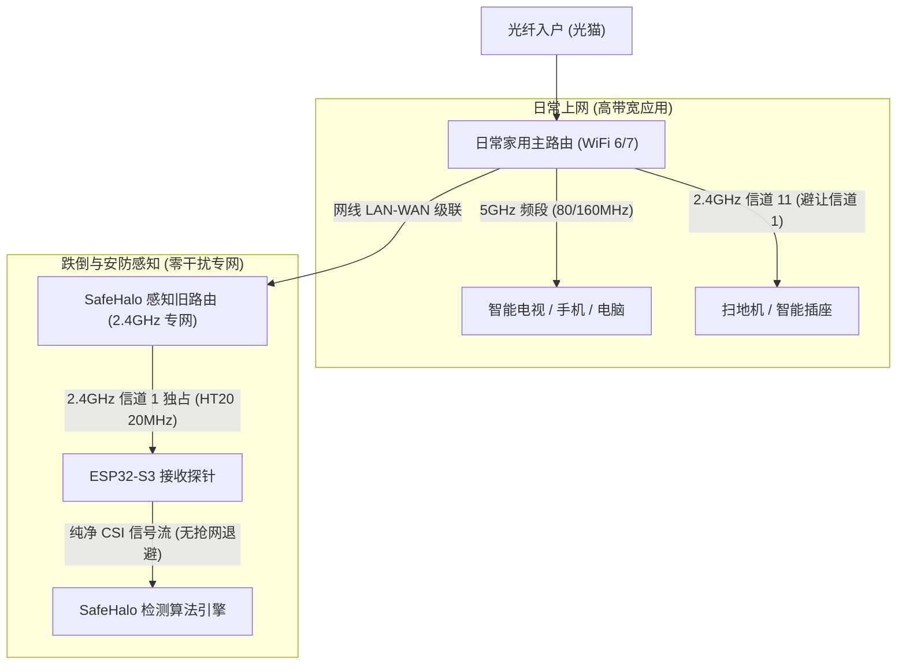

# SafeHalo 家庭多 Wi-Fi 组网适配与感知算法调优指南

在真实家庭环境中，普遍存在**主路由 + 级联旧路由**、**双频合一 (2.4G+5G)** 或 **全屋分布式 Mesh 组网**。

多个 Wi-Fi 既可能因**同频信道争抢和漫游切换**成为算法误报的元凶，也能通过**合理的空间拓扑规划升级为「多链路空间分集 (Multi-Link Spatial Diversity)」**，彻底消除单链路感知盲区并实现房间级定位。

---

## 一、家庭多 Wi-Fi 的三大常见“技术陷阱”

| 陷阱类型 | 产生的物理现象 | 对检测算法的负面影响 | 解决办法 |
|---|---|---|---|
| **陷阱 1：同频竞争 (Co-Channel Contention)** | 多个 AP 均工作在同一 2.4GHz 信道，CSMA/CA 退避冲突 | CSI 发包间隔严重抖动 ($\Delta t$ 达 300ms+)，产生虚假运动方差 | **1/6/11 错频部署**，感知专网独占信道 |
| **陷阱 2：Mesh 自动漫游 (BSSID Hopping)** | 多个子路由使用相同 SSID，ESP32 探针在子母路由间漫游跳跃 | 切换 AP 瞬间信道矩阵突变 1000%，直接误触**跌倒误报警** | **BSSID MAC 物理地址硬锁定**，拒绝漫游 |
| **陷阱 3：双频合一 (Band Steering)** | 路由器尝试把 2.4G 设备踢到 5G 频段 (发送 Deauth 帧) | ESP32 出现周期性断线重连，检测链路闪断 | **关闭双频合一**，固定 2.4GHz HT20 频宽 |

---

## 二、组网拓扑规划：从“冲突互扰”到“感知专网”

### 推荐方案：感知专网与日常上网频段完全隔离



#### 关键参数配置清单：
1. **信道规划（1 / 6 / 11 黄金法则）**：
   - 将日常主路由的 2.4GHz 固定为 **信道 6 或 11**。
   - 将专用于 SafeHalo 的旧路由器固定为 **信道 1**。
   - 两个信道在频域完全无重叠，互不争抢无线电介质，**消除 95% 以上的发包时间抖动**。
2. **频宽设定（Channel Bandwidth）**：
   - 旧路由器频宽务必固定为 **20MHz (HT20)**，严禁选择 40MHz（40MHz 会横跨大部分 2.4G 频段，失去错频意义）。
3. **关闭弱信号踢出**：
   - 在路由器无线高级设置中，关闭「802.11r 快速漫游」与「弱信号自动剔除 (RSSI threshold)」。

---

## 三、利用多 Wi-Fi 升级「多链路空间分集算法」

如果您家中有多个旧路由器或分布式 AP，单链路（1 个 AP + 1 个探针）在检测人体跌倒时存在**物理盲区**：
- **单链路盲区**：当老人跌倒方向**严格平行于 AP 与探针的视距连线（LOS）**时，身体在垂直反射面上的多普勒频移最小，易发生漏报。
- **多链路破局**：在客厅部署 AP-1，在卧室部署 AP-2，探针位于走廊或中央区域，形成两组约 60°~90° 的交叉菲涅尔区。

```text
                  [ 卧室路由器 (AP-2) ]
                            |
                            | (链路 2: 垂直方向)
                            v
   [ 客厅路由器 (AP-1) ] ------> [ ESP32 接收探针 ]
             (链路 1: 水平方向)
```

### 多链路融合算法的核心调优机制 (`src/safehalo/multilink_fusion.py`)：

#### 1. 多 BSSID 独立流解耦与基线隔离
不同房间的墙体材质、空间容积与家具分布完全不同，**各链路必须维护独立的基线统计模型**：
```python
# 每个链路独立建立归一化滤波与动态基线
self.detectors[mac] = RouterCSIDetector(calibration_seconds=4.0)
```

#### 2. 最大比空间能量融合（消解盲区）
当老人跌倒时，即使在链路 1 处于反射盲区（$\Delta E_1$ 较弱），但由于运动必然与链路 2 形成大夹角切割，链路 2 将出现强烈多普勒涌浪（$\Delta E_2$ 巨大）。
算法采用加权融合能量：
$$\Delta E_{\text{fused}} = \max(E_1, E_2) + 0.35 \times \min(E_1, E_2)$$
任何单一链路捕获到高可信冲击，即可触发复核，彻底杜绝单视距漏报。

#### 3. 空间交叉校验（消除环境局部假阳性）
- **局部干扰**：如主卧窗帘飘动或风扇转动，仅引起主卧 AP-2 的单点微扰，客厅 AP-1 保持死寂。
- **真实人体活动**：老人在室内走动或重度坠地，无线电多径会在全屋产生空间相关扰动。
- 算法实施「空间多径投票」，有效过滤单一局部的物理扰动。

#### 4. 房间级微定位推断（Room-Level Localization）
通过对比各链路到达探针的差分动能衰减比：
$$\text{Ratio} = \frac{E_{\text{客厅}}}{E_{\text{主卧}}}$$
- 若 $\text{Ratio} > 2.0$，系统自动推断受检者位于 **【客厅】**；
- 若 $\text{Ratio} < 0.5$，系统自动推断受检者位于 **【主卧】**。
手机微信报警推送将由模糊的“检测到疑似跌倒”升级为精确的 **“🚨 老人在【客厅】疑似跌倒，请尽快查看！”**。

---

## 四、实操验证：多链路仿真与串口运行

在无硬件环境下，可直接启动多链路引擎仿真验证多路由器协同：

```bash
python3 -c "
from src.safehalo.multilink_fusion import MultiLinkFusionEngine
engine = MultiLinkFusionEngine(links_config={
    'c0:06:c3:11:11:11': '客厅路由器',
    'c0:06:c3:22:22:22': '主卧路由器'
})
print('多链路空间分集融合引擎初始化成功！')
"
```

在具备两台路由器的真实环境中：
1. 分别在路由器背面标签上记录它们的 2.4GHz MAC 地址（BSSID）。
2. 在 `safehalo_service.py` 启动时指定或在 Web 控制台配置多 BSSID 白名单，算法即可自动并行解耦两个 Wi-Fi 的空间反射流。
