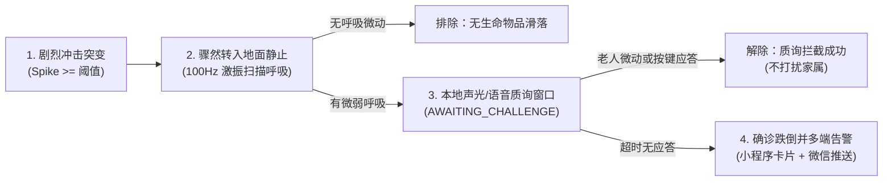

# 阶段 2：闭环验证与 3–5 户入户试点（第 3–6 周）

目标：在阶段 1 验证 Wi-Fi CSI 物理可行性的基础上，完成 **「四段式无应答跌倒确认闭环」**、**「多日环境基线自动校准」**、**「微信小程序订阅消息与误报反馈调参」**，并在 **3–5 户典型老人家庭** 中开展入户试点，将每户每月误报次数控制在 **≤ 2 次**。

---

## 1. 四段式跌倒判定与质询无应答闭环 (`targeted_inspector.py`)

为彻底避免单纯动作分类带来的日常弯腰、快速坐下误报，阶段 2 实施严格的时序递进闭环：

- **核心代码**：[`TargetedFallInspector`](file:///Users/yifanwang/workspace/SafeHalo/src/safehalo/targeted_inspector.py#L45)
- **硬件联动**：进入 `AWAITING_CHALLENGE` 阶段时，自动向串口发送 `CHALLENGE_BEEP:1\n` 驱动探针蜂鸣器或智能音箱温和询问：“*检测到疑似跌倒，如您安全请轻微动一下或按键取消*”。
- **主动解除接口**：支持本地按键、智能音箱或手机调用 `POST /api/challenge/acknowledge`（或 [`acknowledge_safe()`](file:///Users/yifanwang/workspace/SafeHalo/src/safehalo/targeted_inspector.py#L72)）一键解除预警。

---

## 2. 安装后多日自动校准引擎 (`auto_calibrator.py`)

- **核心代码**：[`ContinuousAutoCalibrator`](file:///Users/yifanwang/workspace/SafeHalo/src/safehalo/auto_calibrator.py#L36)
- **三大自校准机制**：
  1. **开机走动抗污染保护（Boot Contamination Guard）**：若设备通电校准期间屋内恰好有人走动（方差超过 `0.0025`），自动拒绝被污染的高能量样本，回退至历史持久化基线或安全默认值，待房间首次安静后再无感标定。
  2. **24 小时分时段静默窗口自学习（Circadian Quiet-Window EMA）**：在日常 `EMPTY` 状态持续超过 30 秒时，自动采集静默样本并按小时更新 24 小时本底噪声画像（`hourly_variance` / `hourly_diff`）。
  3. **温漂与家具挪动自适应**：随安装天数增加（记录于 `logs/baseline_model.json`），自动平滑适应昼夜温湿度漂移及桌椅挪动造成的多径变化。

---

## 3. 家属端微信小程序对接与误报反馈闭环 (`miniprogram_bridge.py`)

- **核心代码**：[`WeChatMiniProgramBridge`](file:///Users/yifanwang/workspace/SafeHalo/src/safehalo/miniprogram_bridge.py#L59) 与 [`IncidentFeedbackManager`](file:///Users/yifanwang/workspace/SafeHalo/src/safehalo/miniprogram_bridge.py#L168)
- **双通道对接**：
  - **对接现有小程序云后端**：配置 `backend_api_url` 与 `backend_api_token`，告警时自动推送携带唯一 `event_id` 与小程序跳转路径（`pages/alert/detail?event_id=...`）的 JSON 载荷。
  - **微信官方订阅消息直推**：配置 `appid`、`appsecret`、`template_id` 与家属 `subscriber_openids`，直接调用 `cgi-bin/message/subscribe/send` 下发服务通知卡片。
- **家属误报归因与靶向调参**（`POST /api/incidents/feedback`）：
  | 误报归因 (`category`) | 典型场景 | 系统自动执行的靶向调优策略 |
  | :--- | :--- | :--- |
  | `pet` | 猫狗跑跳误触 | 宠物子载波参与率阈值 `pet_spr_threshold` 自动上浮 `+0.05` |
  | `shower_water` | 卫生间洗澡水流 | 自动开启水流微动低通阻尼 `water_flow_damping = True` |
  | `curtain_fan` | 窗帘飘动/风扇摇摆 | 扩大 Hampel 滤波窗口 `+2` 并上浮冲击阈值 `+8%` |
  | `dropped_object` / `normal_sit_lie` | 枕头掉落/快速坐卧 | 冲击阈值自动上浮 `+10%`，静止确认时长延长 `+0.5s` |

---

## 4. 3–5 户入户试点与每户每月误报统计 (`pilot_telemetry.py`)

- **核心代码**：[`PilotHouseholdManager`](file:///Users/yifanwang/workspace/SafeHalo/src/safehalo/pilot_telemetry.py#L96)
- **5 户标准试点家庭画像**：
  - `H01`：78 岁独居老人（一室一厅+独立卫浴，验证卫生间防滑与日常作息）
  - `H02`：72 岁独居携猫狗老人（两室一厅，验证宠物 SPR 过滤免疫）
  - `H03`：81/79 岁老年夫妇（双人同住+双 AP 多链路，验证多人活动与起夜）
  - `H04`：84 岁慢病虚弱老人（卧室床头看护，验证床面翻身避让与晨起监测）
  - `H05`：76 岁老旧密集公寓老人（12 个邻居同频 Wi-Fi，验证邻居信号隔离）
- **实时统计接口**：
  - `GET /api/phase2/pilot`：拉取各试点户当月误报次数、质询窗口拦截次数、真实告警次数、达标率（目标：**每户每月误报 ≤ 2 次**）及基线自学习成熟度。
